<p align="center"></p>

<p align="center"><b>Alle Reisen auf einer Karte – direkt in Home Assistant, komplett lokal.</b><br>
<a href="README.md">🇬🇧 English</a></p>

Worldmap ist ein Home-Assistant-Add-on, das sammelt, wo du überall warst – live von den Handys, aus Exporten der
Google-Zeitachse und aus Reiselisten. Es erkennt Reisen, stellt ein paar kluge Fragen („Wer war dabei?“) und zeigt alles
auf einer schnellen, schönen Karte mit fünf Ansichten. Alles läuft im Add-on, kein Cloud-Dienst nötig.


> Alle Screenshots zeigen erfundene Beispieldaten („Alex“ und „Sam“).

## Funktionen

| | |
|---|---|
| 🗺️ **Fünf Kartenansichten** | **Reisen** (wer war wo und womit, Ziele, Flugbögen, Flächen, die zu einer Form verschmelzen, geschätzte Wege mit Fähren für Reisen ohne GPS), **Spuren** (jeder Weg, gefärbt nach Verkehrsmittel, Jahr oder Person), **Orte & Tage** (wo ihr Zeit verbracht habt, Kalender mit jedem Tag), **Regionen** (Kantone, Bundesländer und Provinzen weltweit) und **Reisefilm** (die Kamera fliegt von Reise zu Reise, jede Route zeichnet sich mit Flugzeug, Zug, Auto oder Fähre, Titelkarten, Jahres-Kapitel und Zähler – auch als Video speicherbar). |
| 🛤️ **Echte Bahn- und Strassenlinien** | Lücken zwischen GPS-Punkten werden auf das echte Bahn- und Strassennetz aus OpenStreetMap gelegt. Das Netz entsteht aus Kartenkacheln, die einmal per Kachelnummer geladen und im Add-on gespeichert werden – es werden nie Positionen gesendet, danach läuft alles offline. Reisen ohne GPS (von Hand erfasst) bekommen für Auto, Wohnmobil und Bus den **echten Weg von einem Routendienst** – OpenStreetMap (gratis) oder Google, jede Etappe einmal angefragt und gespeichert; nur Start und Ziel, auf ~2 km gerundet, verlassen das Add-on. Ohne Dienst und bei langen Lücken folgen die Linien den Hauptstrassen, Bahnlinien und Fähren eines Offline-Weltnetzes (gerade fliegen nur Flugzeuge); kurze Lücken ohne plausiblen Weg werden fein gepunktet verbunden (einstellbar: gepunktet, gerade, offen). Flüge beginnen und enden am echten Flughafen (OurAirports, offline). |
| ❓ **Kluge Fragen – ohne KI** | Ähnliche Reisen (gleiche Gegend, gleiche Art Tag, gleicher Vorschlag) kommen als **eine** Frage – eine Antwort für alle. Antworten lassen sich als **Regel** merken, dieselbe Frage kommt nie wieder. Antworten: jede Person und Gruppe, „Keine Reise (Alltag)“, „Mit Reise davor zusammenlegen“, „Einzeln fragen“. Reisen, bei denen nur das Land bekannt ist, bekommen die Frage **„Wo genau?“** – Ort, Insel oder Region eintippen. |
| 👥 **Personen & Gruppen** | Einzelpersonen und Gruppen (Paar, Familie …) mit Farben. Oben in jeder Karte: alle, eine Person oder eine Gruppe antippen. Zuhause und Arbeit mit Umkreis; die Arbeit erscheint nur auf der Karte, wenn du es einschaltest. |
| 📋 **Reiseliste wie in Excel** | Jede Reise hat einen **Namen** und ihre **Stationen** – Orte oder Flughäfen der Reihe nach, jede mit eigenem Verkehrsmittel (Auto, Zug, Bus, Flug, Wasserflugzeug, Schiff, Wohnmobil, Velo, zu Fuss); Länder und Verkehrsmittel ergeben sich aus den Stationen. In den Einstellungen: Filter pro Spalte, sortieren (neueste oder älteste, km, Nächte, Name, Land, Person – leere Werte zuletzt), Zellen direkt bearbeiten, Zeilen löschen, Zeilen direkt aus Excel oder Google Sheets einfügen (Strg+V). Doppelte werden erkannt. |
| 💾 **Alles in einer Datei** | Das *Worldmap-Paket* enthält alle Reisen mit „Wer war dabei“ und alle GPS-Positionen mit Person – als Sicherung herunterladen und überall wieder importieren. |
| 📦 **Daten & Import** | Eine Seite, die jeden Weg erklärt, wie Daten hineinkommen – von Hand, Worldmap-Paket (das Standardformat dieser Karte), Google-Zeitachse, Home-Assistant-App, OwnTracks, iPhone, Fotogalerien mit **exiftool**, **Claude** die GPS-Daten deiner Fotos auflisten lassen – mit kurzen Knöpfen und pulsierenden ⓘ-Info-Knöpfen für die Details. **Mit KI umwandeln:** eine fertige Anleitung mit dem Worldmap-Format (Kopieren-Knopf und Beispieldatei) – zusammen mit Daten in einem anderen Format einer KI geben und die Antwort hier ablegen. |
| 📥 **Alles importieren** | Reiselisten (CSV/Excel mit Wann oder Von/Bis, Name oder Ziel, Stationen …) – die Ziele landen automatisch auf der Karte –, Google-Zeitachse (Takeout und Export vom Handy, Android und iPhone), iCloud-/exiftool-Foto-CSV, jede CSV/Excel mit Koordinaten, GPX, KML. Aufgezeichnete Reisen (Google-Zeitachse, OwnTracks, Home Assistant, Fotos, GPX) bekommen ihre Stationen aus den Orten, an denen ihr übernachtet habt, mit dem Verkehrsmittel aus den Daten – ein Flug landet am echten Flughafen. Eine Vorschau zeigt, was gefunden wurde; Vorhandenes wird nicht doppelt gespeichert. |
| 📡 **Live ohne Cloud** | Positionen aus `person.*`- / `device_tracker.*`-Entitäten und ein eingebauter **OwnTracks**-Empfang: das Handy sammelt unterwegs und schickt alles, sobald es wieder im Heimnetz ist – ohne Nabu Casa, ohne offenen Port ins Internet. |
| 📅 **Ungenaue Daten** | Eine Reise kann genaue Tage, nur einen Monat oder nur ein Jahr haben – „13.–25.07.2009“, „Juli 2009“ oder „2009“ in die Spalte *Wann* tippen (auch in importierten Listen und Paketen). Karten, Film und Statistik legen sie in die Mitte des Monats oder Jahres und zeigen sie mit „~“. |
| ✍️ **Reisen von Hand** | Der „+“-Knopf fragt kurz nach (Name und Stationen, wann, wie lange, wer, wie gross war die Gegend) – für alte Reisen ohne Daten, überall auf der Welt. Mehrere Stationen mit eigenem Verkehrsmittel, beliebig sortierbar (nach oben und unten schieben) (Flug nach Teneriffa, Schiff nach La Gomera; Flug nach Malé, **Wasserflugzeug** zum Atoll – es fliegt direkt von der vorherigen Station); eine Station kann auch ein **Flughafen** sein – Suche nach Stadt, Flughafen-Name oder Code („Dubai“ → DXB, DWC; „Male Flughafen“ → MLE), das Flugzeug landet genau dort und die nächste Station startet von dort, und „Abflug ab“ wählt einen anderen als deinen Heimatflughafen; Orte aus der eingebauten Liste, aus OpenStreetMap, Google Maps oder einem eingefügten Google-Maps-Link. Autos folgen den echten Strassen (Routendienst), Züge Bahnlinien, Schiffe dem Meer. Ungenaue Reisen (nur ein Land) sind in der Reiseliste markiert. |
| 📊 **Dashboard** | Die Reisen als Zahlen und kleine Bilder statt als Karte: Kennzahlen, um die Erde (und zum Mond), Rekorde, ein Länder-Pass mit Stempeln, eine **Postkarte** pro Reise – die echte Karte mit der Route (Flugbögen, Strassen, Fähren, GPS-Spuren), „Grüsse aus“-Schriftzug, Briefmarke des Landes und Poststempel; antippen dreht sie um (Grüsse, Daten, km pro Verkehrsmittel, wer dabei war, Stationen), wischen oder ‹ › blättert, 🎲 zeigt eine zufällige Erinnerung, ⬇ speichert sie als Bild – ein Kalender der Reisetage, ein Zeitstrahl mit einer Spur pro Person, ein Reise-Rad (wann im Jahr und womit), Lieblingsorte, km und geschätztes CO₂ pro Jahr und „weisse Flecken“ (wie viele Regionen pro Land ihr kennt). Fünf fertige Dashboards als Bildkarten – **Übersicht, Jahresrückblick, Familie, Entdecker, Wandtablet** (grosse Schrift, die Postkarte wechselt alle 15 Sekunden) – oder eine eigene Auswahl mit ✏️ *Anpassen*; Personen und Gruppen als runde Avatare. Jede Kachel hat eine ⓘ-Erklärung. Das Dashboard ist der erste Tab; Worldmap öffnet aber weiterhin auf der Karte. |
| 🔔 **Benachrichtigungen** | Eines deiner Handys wählen (wird automatisch gefunden) oder Hinweis in Home Assistant, wie oft (sofort, täglich, wöchentlich), Test senden. |
| ✨ **Animierte Karte** | Kleine Flugzeuge in der Farbe der Reise fliegen die Flugbögen ab, Züge und Autos fahren Reisen ins Ausland nach. Ein Schalter auf jeder Karte, flüssige 60 fps. |
| 🎨 **Kartenstil mit Versionen** | Jede Karte hat ihre eigenen Einstellungen (Höhe der Flugbögen, Schriftgrösse, Kreisgrössen, Regionsgrenzen, Form der Flächen, Filmtempo …), dazu Farben, sechs Linientypen und die Animation: welche Fahrzeuge, ab welcher Entfernung, wie viele, wie schnell. Einstellen mit dem 🎨-Knopf direkt auf der Karte oder in den Einstellungen, wo deine eigene Karte die Live-Vorschau ist. Jedes Speichern ist eine Version, zu der du zurück kannst. |
| 🌙 **Hell & dunkel** | Folgt dem System oder dem ☾/☀-Knopf auf der Karte; Seen, Grenzen und Küsten bleiben auch im Dunkeln sichtbar. |
| 📊 **Sensoren** | `sensor.worldmap_km_this_year`, `sensor.worldmap_trips`, `sensor.worldmap_countries`, `sensor.worldmap_open_questions`, `sensor.worldmap_last_trip`. |

| Spuren | Orte & Tage | Regionen | Reisefilm |
|---|---|---|---|
| 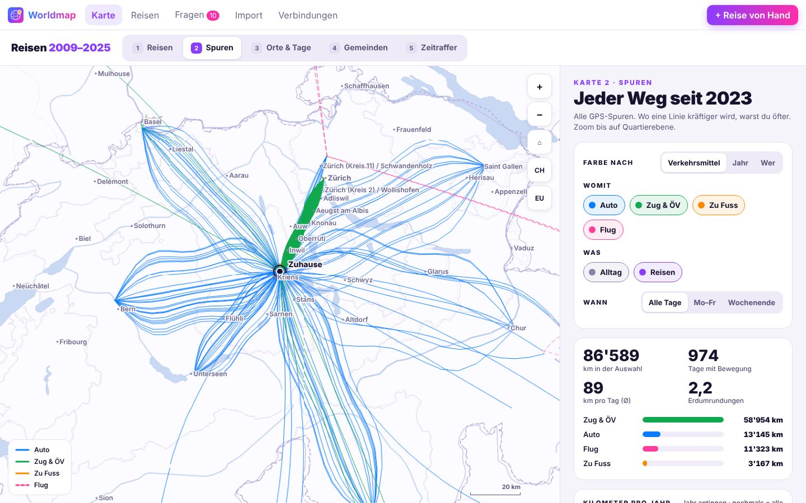 |  | 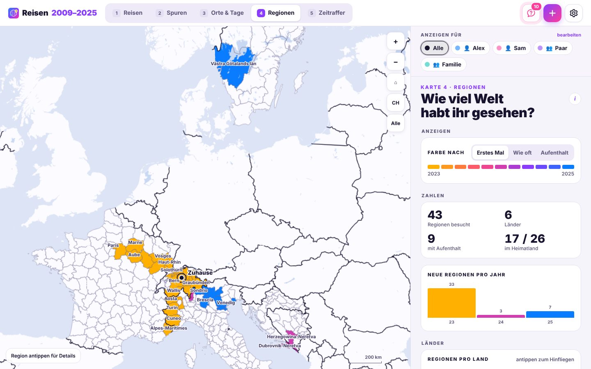 | 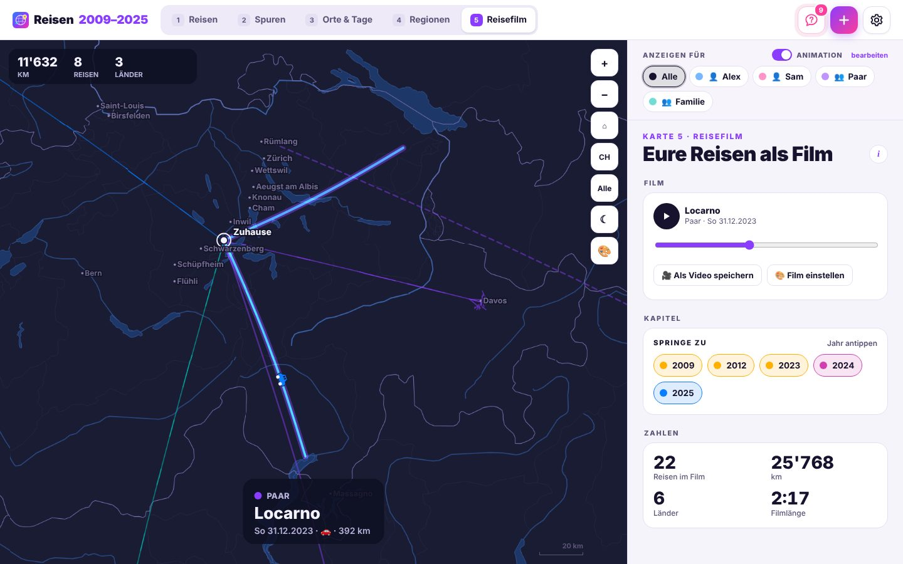 |

| Personen & Gruppen | Fragen | Reiseliste |
|---|---|---|
| 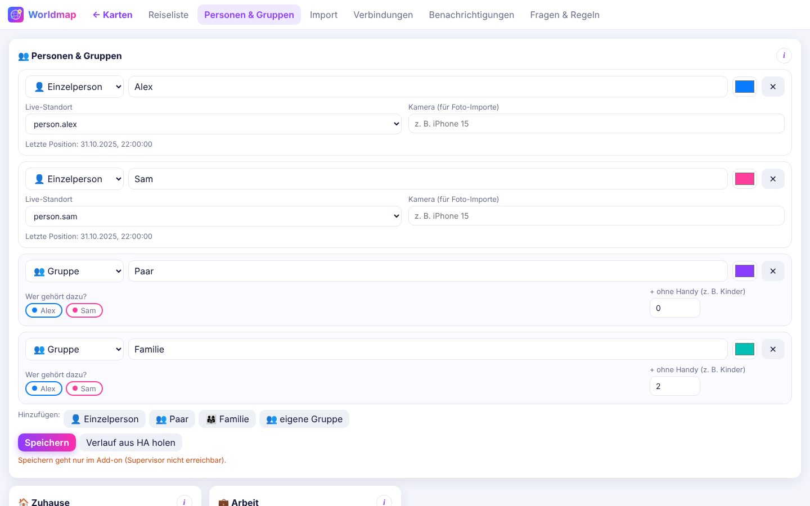 | 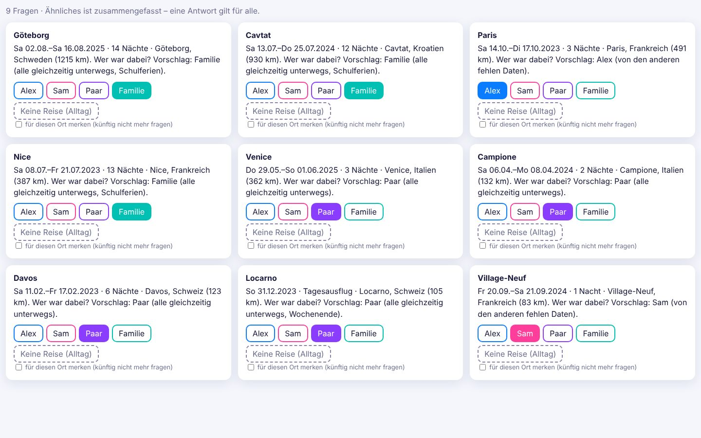 | 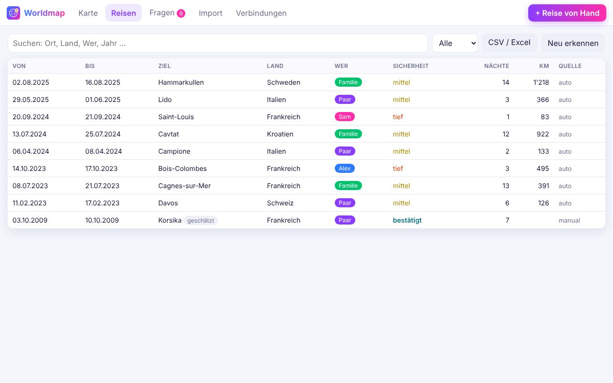 |

| Stationen mit Flughafen und Wasserflugzeug | Reise von Hand: Flughafen per Stadt finden | Daten & Import: alle Wege |
|---|---|---|
| 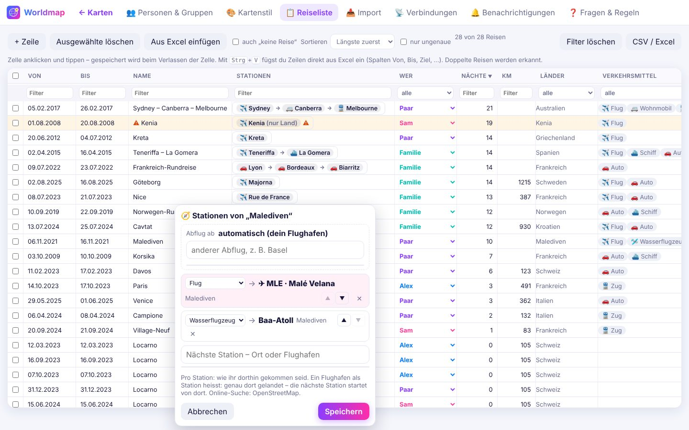 | 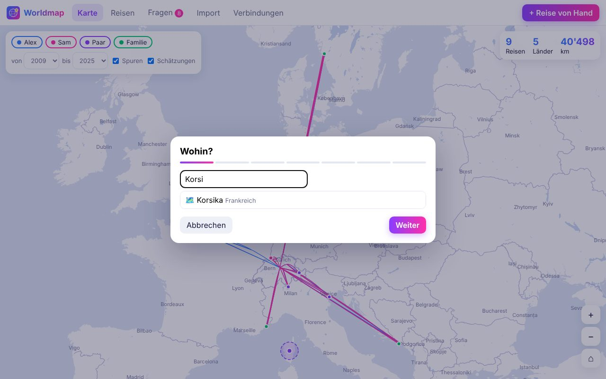 | 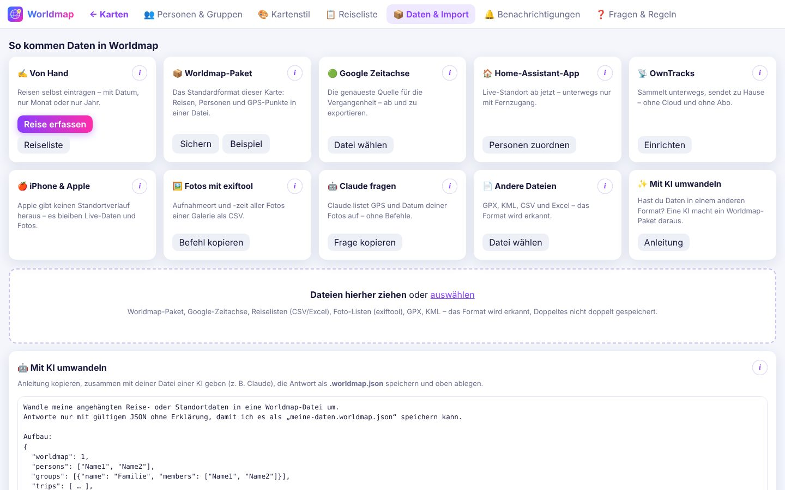 |

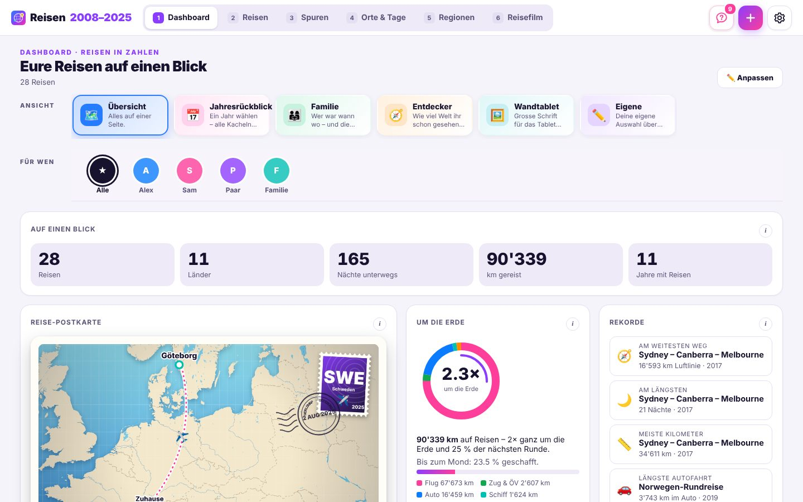

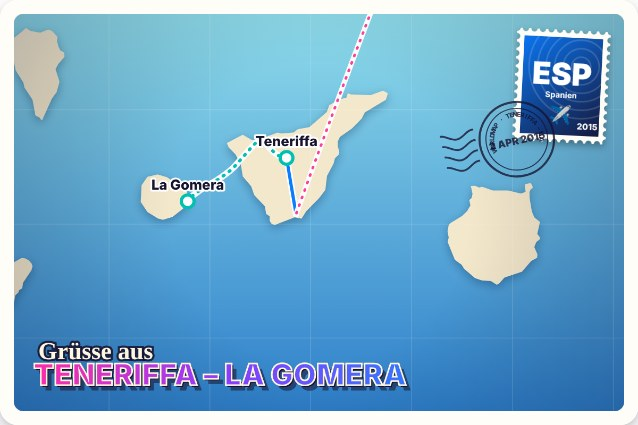

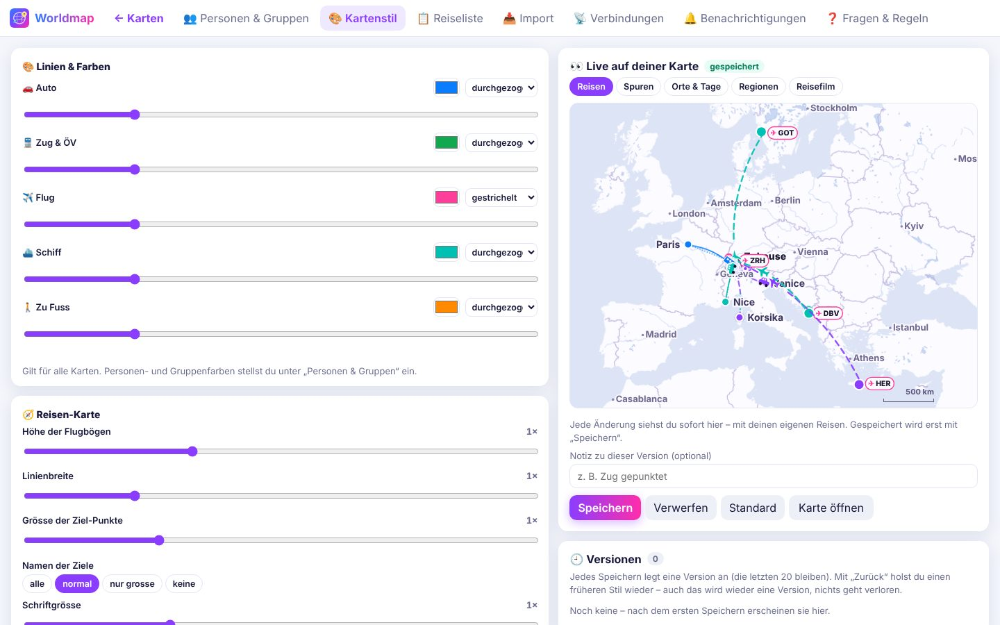

## Installation

1. In Home Assistant **Einstellungen → Add-ons → Add-on Store → ⋮ → Repositories** öffnen und
   `https://github.com/magi1982/worldmap` hinzufügen.
2. **Worldmap** installieren, starten und **In Seitenleiste anzeigen** einschalten.
3. Worldmap öffnen → ⚙️ **Einstellungen → Personen & Gruppen**: Personen (mit Handy) und Gruppen wie Paar oder Familie anlegen.

## So kommst du an Standortdaten

| Quelle | Automatisch? | Wie |
|---|---|---|
| **OwnTracks-App** (iPhone & Android) | ✅ live, ohne Cloud | Einstellungen → Daten & Import → OwnTracks: Benutzer anlegen. In den *Netzwerk*-Einstellungen des Add-ons Port `8098` eintragen. In der App: Modus *HTTP*, URL `http://<IP-von-Home-Assistant>:8098/pub`, Benutzer und Passwort. Das Handy sammelt unterwegs und schickt zu Hause. |
| **Home-Assistant-App** | ✅ live | `person.*`-Entität mit GPS. Liefert nur, solange das Handy Home Assistant erreicht – unterwegs braucht es einen Fernzugang: Home Assistant Cloud (Nabu Casa) oder ein eigenes VPN (WireGuard-/Tailscale-Add-on) bzw. eine eigene Domain. Offline speichert die App keine Positionen. |
| **iCloud „Wo ist?“** | ✅ | HACS-Integration *iCloud3* (braucht die Apple-ID). |
| **Google-Maps-Zeitachse** | ⚠️ Export | Google speichert die Zeitachse nur auf dem Handy. Ab und zu exportieren (*Android: Einstellungen → Standort → Zeitachse → Exportieren*; *iPhone: Google Maps → Profil → Zeitachse → ⋯ → Exportieren*) und unter **Import** ablegen. |
| **Reiselisten** | ⚠️ Import / Einfügen | CSV oder Excel mit Spalten wie Wann (oder Von, Bis), Ziel, Land, Wer – oder Zeilen in die Reiseliste einfügen. |
| **Fotos** | ⚠️ Import | Aufnahmeort und -zeit als CSV mit exiftool (`exiftool -csv -n -r -GPSLatitude -GPSLongitude -DateTimeOriginal "ORDNER" > fotos.csv`) oder von Claude (Desktop-App mit Ordnerzugriff) auflisten lassen und importieren; die Kamera ordnet die Fotos den Personen zu. |
| **Alles andere** | ⚠️ Umwandeln | Die KI-Anleitung unter *Daten & Import* kopieren und eine KI die Datei in ein Worldmap-Paket umwandeln lassen. |
| **Apple „Wichtige Orte“** | ❌ | Apple bietet keinen Export und keine Schnittstelle. |

## Einstellungen

Alles lässt sich in der App (⚙️ **Einstellungen**) oder in der Add-on-Konfiguration einstellen; jede Option hat eine Beschreibung.

| Option | Standard | Bedeutung |
|---|---|---|
| `persons` | – | `label` (Name), optional `entity` (`person.x` / `device_tracker.x`), `camera_models` für Foto-Importe |
| `owntracks` | – | `user`, `password` (≥ 8 Zeichen), `label` (Person) für den OwnTracks-Empfang auf Port 8098 |
| `groups` | – | `name`, `members` (Personen mit Komma), `extra` (Personen ohne Handy), `color` |
| `home_radius_m` | 0 | Umkreis Zuhause in Metern; 0 = Radius der Zone |
| `work_lat` / `work_lon` / `work_radius_m` | – / – / 300 | Arbeit; leer = automatisch erkannt |
| `show_work` | false | Arbeit auf der Karte zeigen |
| `place_search` | osm | Ortssuche beim Erfassen: `offline`, `osm` (OpenStreetMap, gratis) oder `google` (braucht `google_maps_api_key`) – gesendet wird nur das Suchwort |
| `route_service` | osm | echte Strassen für Auto-, Wohnmobil- und Busetappen von Reisen ohne GPS (von Hand erfasst oder nur Stationen): `osm` (OpenStreetMap-Routing-Server von FOSSGIS, gratis, für leichte Nutzung), `google` (Google Routes API, braucht `google_maps_api_key` mit der Routes API; 10'000 Anfragen pro Monat gratis) oder `offline` (eingebautes Netz, nichts wird gesendet). Jede Etappe wird einmal angefragt und gespeichert; gesendet werden nur Start und Ziel, auf ~2 km gerundet. Flüge bleiben Bögen. Auch in der App unter Verbindungen › Geschätzte Routen, mit dem Knopf „Routen neu berechnen“ |
| `google_maps_api_key` | "" | eigener Google-Schlüssel: Places API (New) für `place_search: google`, Routes API für `route_service: google` |
| `home_airport` | "" | IATA-Code des Heimatflughafens (z. B. ZRH); leer = der Flughafen, von dem die meisten aufgezeichneten Flüge starten |
| `min_trip_km` | 30 | mit Übernachtung zählt es ab dieser Entfernung als Reise |
| `min_day_trip_km` | 100 | ein Tagesausflug ohne Übernachtung zählt ab dieser Entfernung als Reise |
| `routine_days` | 20 | Orte, an denen man an so vielen Tagen war (Arbeit, Schule), starten keine Reise; 0 = aus |
| `ask_below` | `hoch` | fragen, wenn die Sicherheit tiefer ist |
| `school_holidays` | – | Zeiträume wie `2026-07-04..2026-08-09` – schlägt „Familie“ vor |
| `hint_keywords` | – | `Wort=Antwort` – wird vorgeschlagen, wenn ein Datei- oder Ordnername das Wort enthält |
| `routing` | `tiles` | `tiles` = Bahn-/Strassennetz aus OpenStreetMap-Kacheln (nach dem ersten Laden lokal); `off` |
| `notify_service` / `notify_mode` | – / `weekly` | z. B. `notify.mobile_app_handy`; `off`, `instant`, `daily`, `weekly` |

## Datenschutz & Sicherheit

- Der Standortverlauf bleibt im Ordner `/data` des Add-ons (Teil deiner Home-Assistant-Backups). Nichts wird hochgeladen.
  Geladen werden nur OpenStreetMap-Kacheln per Kachelnummer (einmal, danach gespeichert).
- Die Oberfläche ist nur über Home Assistant Ingress erreichbar. Der optionale OwnTracks-Port nimmt nur angemeldete `POST`s an.
- Eingabeprüfung, parametrisiertes SQL, XXE-sicheres XML, CSV-Export ohne Formel-Einschleusung, Content-Security-Policy, escapte Ausgaben.
- CI: Tests, Ruff, Bandit, pip-audit, CodeQL, Dependabot, Home-Assistant-Add-on-Linter und ein Datenschutz-Check. Siehe [SECURITY.md](SECURITY.md).

## Entwicklung

```bash
pip install -r requirements-dev.txt
python -m pytest
python tools/demo.py /tmp/demo        # erfundene Beispieldaten
WORLDMAP_DATA=/tmp/demo WORLDMAP_ALLOWED_IPS=127.0.0.1 PYTHONPATH=worldmap/app python -m worldmap
# http://127.0.0.1:8099 öffnen
```

Ideen und Planung stehen in [NEXT.md](NEXT.md).

## Quellen

Karten- und Ortsdaten: [Natural Earth](https://www.naturalearthdata.com/) (gemeinfrei, auch die Regionen und Städtenamen in anderen Sprachen),
Flughäfen: [OurAirports](https://ourairports.com/data/) (gemeinfrei), Hauptstrassen, Fähren und Bahnlinien: Natural Earth (gemeinfrei),
Ortsnamen: [GeoNames](https://www.geonames.org/) (CC BY 4.0). Bahn- und Strassennetz: © [OpenStreetMap](https://www.openstreetmap.org/copyright)-Mitwirkende
via [OpenFreeMap](https://openfreemap.org/); geschätzte Routen: OpenStreetMap-Routing von [FOSSGIS](https://routing.openstreetmap.de/) (© OpenStreetMap-Mitwirkende) oder Google.

Lizenz: MIT
