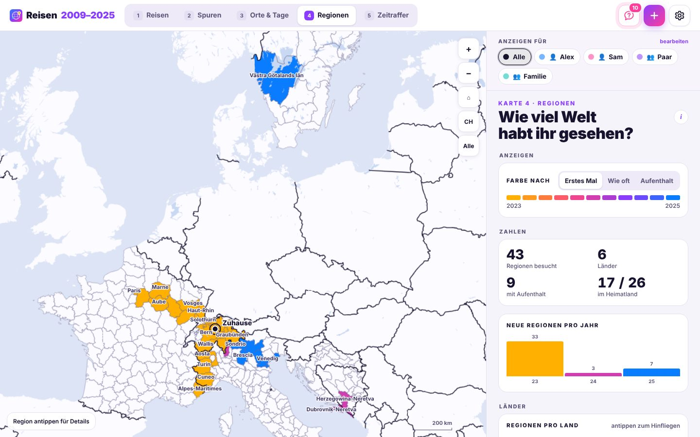
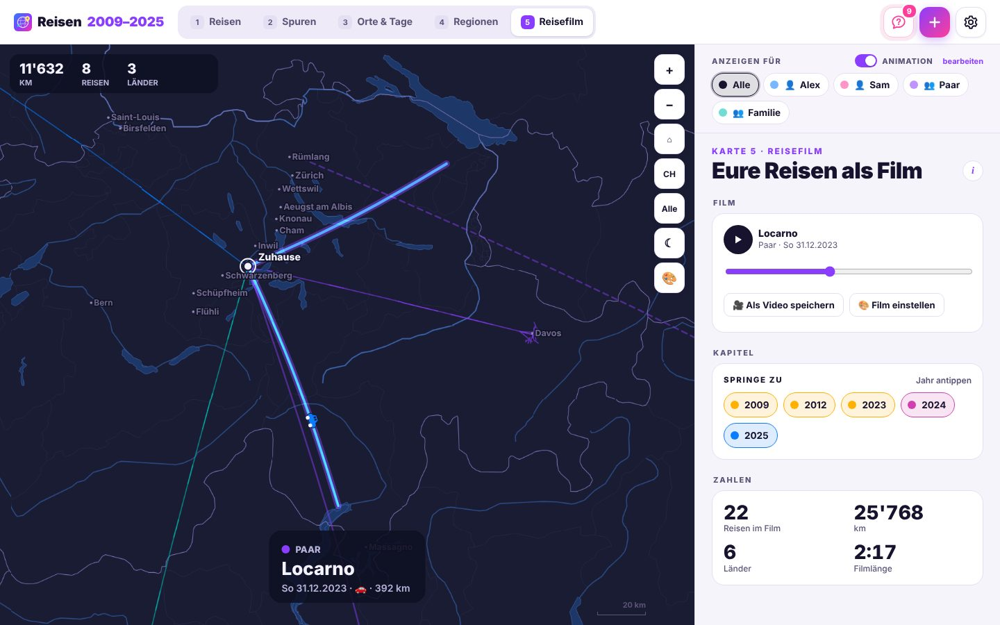
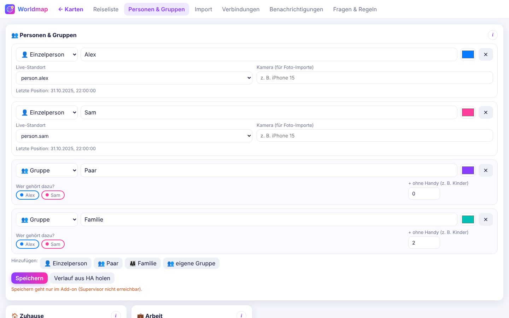
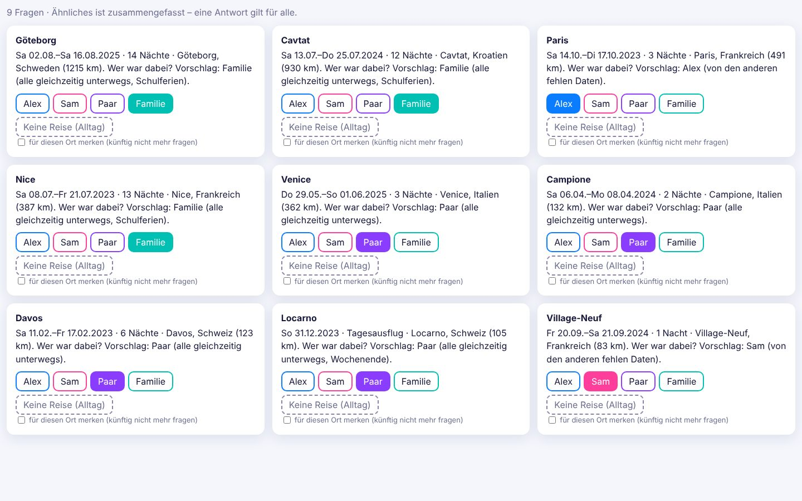
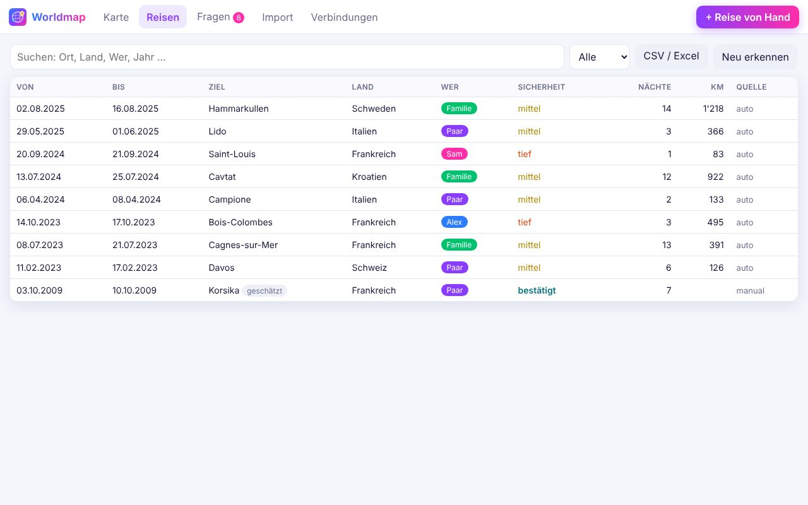
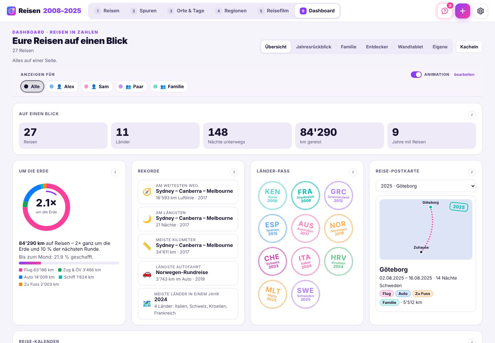
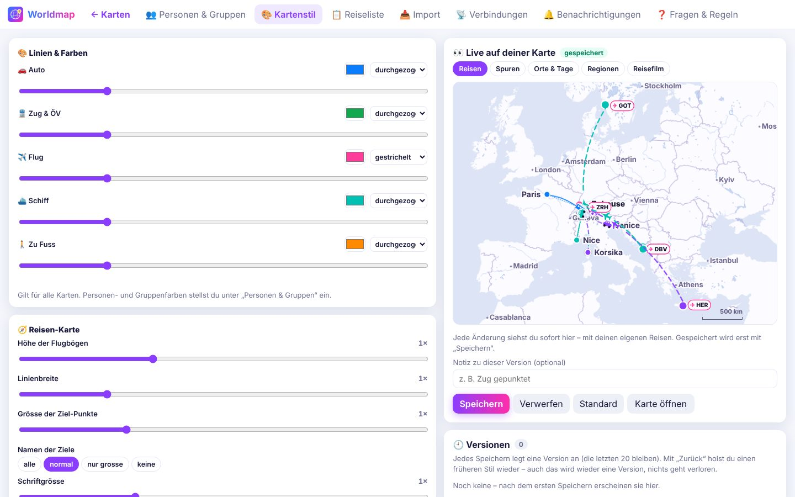

<p align="center"></p>

<p align="center"><b>All your trips on one map – inside Home Assistant, fully local.</b><br>
<a href="README.de.md">🇩🇪 Deutsch</a></p>

Worldmap is a Home Assistant add-on that collects where you have been – live from your phones, from Google Timeline
exports and from trip lists – detects trips, asks a few smart questions ("who was there?") and shows everything on a
fast, good-looking map with five views. Everything runs inside the add-on; no cloud service is needed.


> All screenshots use invented sample data ("Alex" and "Sam").

## Features

| | |
|---|---|
| 🗺️ **Five map views** | **Trips** (who went where and how, destinations, flight arcs, areas that melt together, estimated routes with ferries for trips without GPS), **Tracks** (every route, coloured by transport, year or person), **Places & days** (where you spent time, a calendar of every day), **Regions** (states, provinces and cantons worldwide) and **Travel film** (the camera flies from trip to trip, each route draws itself with its plane, train, car or ferry, title cards, year chapters and counters – can be saved as a video). |
| 🛤️ **Real rail and road lines** | Gaps between GPS points are map-matched onto the real rail and road network from OpenStreetMap. The network is built from map tiles that are downloaded once by tile number and kept in the add-on – no positions are ever sent, afterwards it works offline. Trips without GPS and long gaps follow the main roads, railways and ferries of an offline world network (only planes fly straight); short gaps without a plausible path are joined by a fine dotted line (adjustable: dotted, straight, open). Flights start and end at the real airport (OurAirports, offline). |
| ❓ **Smart questions – no AI needed** | Similar trips (same area, same kind of day, same suggestion) are asked **once** – one answer for all. Answers can be remembered as **rules**, so the same question never comes again. Answers: every person and group, "no trip (everyday life)", "merge with the trip before", "ask one by one". Trips where only the country is known get a **"where exactly?"** question – type a town, island or region. |
| 👥 **People & groups** | Single persons and groups (couple, family …) with colours. A bar on top of every map shows everyone, one person or one group. Home and work with radius; the workplace is hidden on the map unless you switch it on. |
| 📋 **Excel-style trip list** | Every trip has a **name** and its **stations** – places or airports in order, each with its own transport (car, train, bus, plane, seaplane, ship, camper, bike, on foot); countries and transport come from the stations. In the settings: filter per column, sort, edit cells in place, delete rows, paste rows straight from Excel or Google Sheets (Ctrl+V). Duplicates are detected. |
| 💾 **Everything in one file** | The *Worldmap package* holds all trips with who was there and all GPS points with their person – download it as a backup and import it anywhere. |
| 📥 **Import anything** | Trip lists (CSV/Excel with From, To, Name or Destination, Stations …) – destinations are placed on the map automatically – Google Timeline (Takeout and the on-device export for Android and iPhone), iCloud/exiftool photo CSV, any CSV/Excel with coordinates, GPX, KML. Recorded trips (Google Timeline, OwnTracks, Home Assistant, photos, GPX) get their stations from the places where you slept, with the transport found on the way – a flight lands at the real airport. A preview shows what was found before anything is saved; data that is already there is not stored twice. |
| 📡 **Live without cloud** | Positions from `person.*` / `device_tracker.*` entities and a built-in **OwnTracks** endpoint: the phone buffers positions while you are away and sends them when it is back in your home network – no Nabu Casa, no port opened to the internet. |
| ✍️ **Trips by hand** | The "+" button asks a few questions (name and stations, when, how long, who, how big was the area) – for old trips without any data, anywhere in the world. Several stops with their own transport, in any order (move them up and down) (plane to Tenerife, ship to La Gomera); a stop can also be an **airport** – search by town, airport name or code ("Dubai" → DXB, DWC; "Male Flughafen" → MLE), the plane lands exactly there and the next stop starts from there, and "departure from" picks another airport than your home one; places come from the built-in list, OpenStreetMap, Google Maps or a pasted Google Maps link. Cars follow motorways, trains railways, ships the sea. Vague trips (only a country) are marked in the trip list. |
| 📊 **Dashboard** | The trips as numbers and small pictures instead of a map: key figures, around the world (and to the moon), records, a country passport with stamps, a postcard per trip with its route and stops, a calendar of travel days, a timeline with one lane per person, a travel wheel (when in the year and how), favourite places, km and estimated CO₂ per year, and "white spots" (how many regions of each country you know). Five ready-made dashboards – **Overview, Year in review, Family, Explorer, Wall tablet** (big type, the postcard changes every 15 seconds) – or your own choice of tiles. Every tile has an ⓘ explanation and follows the person/group bar. |
| 🔔 **Notifications** | Choose one of your phones (found automatically) or a Home Assistant notification, how often (instant, daily, weekly) and send a test. |
| ✨ **Animated map** | Little planes in the colour of the trip fly the flight arcs, trains and cars travel trips abroad. One switch on every map, smooth 60 fps. |
| 🎨 **Map style with versions** | Every map has its own settings (arc height, label size, circle sizes, region borders, area shape, film tempo …), plus colours, six line types and the animation: which vehicles, from which distance, how many, how fast. Change them with the 🎨 button right on the map or on the settings page, where your own map is the live preview. Every save is a version you can go back to. |
| 🌙 **Light & dark mode** | Follows the system or the ☾/☀ button on the map; lakes, borders and coasts stay visible in the dark. |
| 📊 **Sensors** | `sensor.worldmap_km_this_year`, `sensor.worldmap_trips`, `sensor.worldmap_countries`, `sensor.worldmap_open_questions`, `sensor.worldmap_last_trip`. |

| Tracks | Places & days | Regions | Travel film |
|---|---|---|---|
|  |  |  |  |

| People & groups | Questions | Trip list |
|---|---|---|
|  |  |  |





## Installation

1. In Home Assistant open **Settings → Add-ons → Add-on store → ⋮ → Repositories** and add
   `https://github.com/magi1982/worldmap`.
2. Install **Worldmap**, start it and enable **Show in sidebar**.
3. Open Worldmap → ⚙️ **Settings → People & groups**: add the people (with their phone) and groups such as couple or family.

## Getting location data

| Source | Automatic? | How |
|---|---|---|
| **OwnTracks app** (iPhone & Android) | ✅ live, no cloud | Settings → Connections → OwnTracks: create a user. In the add-on's *Network* settings enter port `8098`. In the app: mode *HTTP*, URL `http://<home-assistant-ip>:8098/pub`, user and password. Positions are buffered on the phone and sent when it is back home. |
| **Home Assistant Companion App** | ✅ live | `person.*` entity with GPS. Only delivers while the phone can reach Home Assistant – from outside the home network you need Nabu Casa, a VPN (WireGuard/Tailscale add-on) or your own domain. |
| **iCloud "Find My"** | ✅ | HACS integration *iCloud3* (needs your Apple ID). |
| **Google Maps Timeline** | ⚠️ export | Google keeps the timeline only on the phone. Export it now and then (*Android: Settings → Location → Timeline → Export*; *iPhone: Google Maps → profile → Timeline → ⋯ → Export*) and drop the file into **Import**. |
| **Trip lists** | ⚠️ import / paste | CSV or Excel with columns like From, To, Destination, Country, Who – or paste rows into the trip list. |
| **Photos** | ⚠️ import | Export capture place and time as CSV (e.g. with exiftool) and import; photos are assigned to people by camera model. |
| **Apple Significant Locations** | ❌ | Apple offers no export or API. |

## Configuration

Everything can be set in the app (⚙️ **Settings**) or in the add-on configuration; each option has a description.

| Option | Default | Meaning |
|---|---|---|
| `persons` | – | `label` (name), optional `entity` (`person.x` / `device_tracker.x`), `camera_models` for photo imports |
| `owntracks` | – | `user`, `password` (≥ 8 characters), `label` (person) for the OwnTracks endpoint on port 8098 |
| `groups` | – | `name`, `members` (comma-separated persons), `extra` (people without a phone), `color` |
| `home_radius_m` | 0 | home radius in metres; 0 = radius of the home zone |
| `work_lat` / `work_lon` / `work_radius_m` | – / – / 300 | workplace; empty = detected automatically |
| `show_work` | false | show the workplace on the map |
| `place_search` | osm | place search when adding a trip: `offline`, `osm` (OpenStreetMap, free) or `google` (needs `google_maps_api_key`) – only the search word is sent |
| `route_service` | osm | real roads for car / camper / bus legs of trips without GPS (entered by hand or only stations): `osm` (OpenStreetMap routing server of FOSSGIS, free, light use), `google` (Google Routes API, needs `google_maps_api_key` with the Routes API; 10,000 free requests a month) or `offline` (built-in network, nothing sent). Each leg is asked once and stored; only start and end rounded to ~2 km are sent. Flights stay arcs. Also in the app under Connections › Estimated routes, with a button "Routen neu berechnen" |
| `google_maps_api_key` | "" | your own Google key: Places API (New) for `place_search: google`, Routes API for `route_service: google` |
| `home_airport` | "" | IATA code of your home airport (e.g. ZRH); empty = the airport most recorded flights start from |
| `min_trip_km` | 30 | with a night away, a trip starts at this distance |
| `min_day_trip_km` | 100 | a day out without a night away counts as a trip from this distance |
| `routine_days` | 20 | places visited on this many days (work, school) never start a trip; 0 = off |
| `ask_below` | `hoch` | ask when the confidence is below this level |
| `school_holidays` | – | ranges like `2026-07-04..2026-08-09` – suggests "family" |
| `hint_keywords` | – | `word=answer` – suggested when a file or folder name contains the word |
| `routing` | `tiles` | `tiles` = rail/road network from OpenStreetMap tiles (local after the first download); `off` |
| `notify_service` / `notify_mode` | – / `weekly` | e.g. `notify.mobile_app_phone`; `off`, `instant`, `daily`, `weekly` |

## Privacy & security

- Location history stays in the add-on's `/data` folder (part of your Home Assistant backups). Nothing is uploaded.
  The only downloads are OpenStreetMap tiles by tile number (once; then cached).
- The UI is only reachable through Home Assistant Ingress. The optional OwnTracks port accepts only authenticated `POST`s.
- Input validation, parameterised SQL, XXE-safe XML, CSV-injection-safe export, Content-Security-Policy, escaped output.
- CI: tests, Ruff, Bandit, pip-audit, CodeQL, Dependabot, Home Assistant add-on linter and a privacy guard. See [SECURITY.md](SECURITY.md).

## Development

```bash
pip install -r requirements-dev.txt
python -m pytest
python tools/demo.py /tmp/demo        # invented sample data
WORLDMAP_DATA=/tmp/demo WORLDMAP_ALLOWED_IPS=127.0.0.1 PYTHONPATH=worldmap/app python -m worldmap
# open http://127.0.0.1:8099
```

Ideas and the roadmap live in [NEXT.md](NEXT.md).

## Credits

Map and place data: [Natural Earth](https://www.naturalearthdata.com/) (public domain, including the regions and city names in other languages),
airports: [OurAirports](https://ourairports.com/data/) (public domain), main roads, ferries and railways: Natural Earth (public domain),
place names: [GeoNames](https://www.geonames.org/) (CC BY 4.0). Rail and road network: © [OpenStreetMap](https://www.openstreetmap.org/copyright)
contributors via [OpenFreeMap](https://openfreemap.org/); estimated routes: OpenStreetMap routing by [FOSSGIS](https://routing.openstreetmap.de/) (© OpenStreetMap contributors) or Google.

License: MIT
