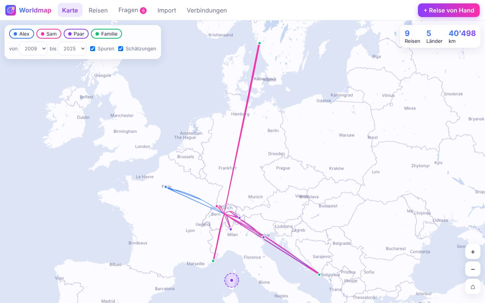
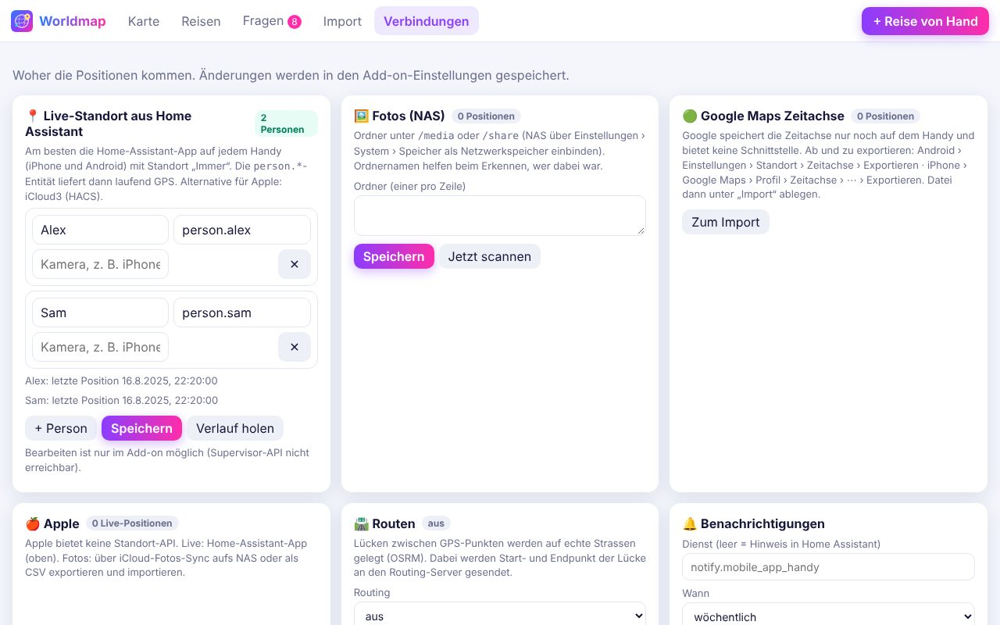
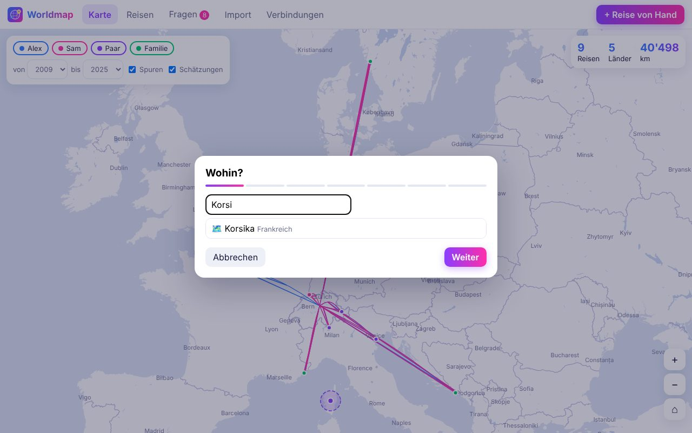

<p align="center"></p>

<p align="center"><b>All your trips on one map – inside Home Assistant.</b><br>
<a href="README.de.md">🇩🇪 Deutsch</a></p>

Worldmap is a Home Assistant add-on that collects where you have been – live from the
Home Assistant Companion App, from the GPS data in your photos and from Google/Apple exports –
detects trips, asks short questions ("who was there?") and shows everything on a fast,
good-looking map.



> All screenshots use invented sample data ("Alex" and "Sam").

## Features

| | |
|---|---|
| 🗺️ **Map** | Tracks, flight arcs and estimated areas for trips without GPS. Filter by person/group and year. Pans and zooms smoothly even with millions of points (bitmap cache, simplified tracks per zoom level, gzip). |
| 📋 **Trip list** | Searchable list with destination, country, who, confidence, nights and distance. Edit any trip; your edits are never overwritten by automatic detection. Export as CSV for Excel. |
| ❓ **Smart questions** | For every new trip Worldmap suggests who was there – using who was away at the same time, weekends, school holidays and words in photo folder names – and only asks when it is unsure. |
| ✍️ **Trip by hand** | A short wizard for old trips without any data (*Where? When? How long? Who? How? How big was the area?*). Regions such as "Corsica" or "Tuscany" come with a sensible area. |
| 📥 **Import anything** | Drop files – the format is detected from the content: Google Timeline (Takeout and the new on-device export for Android and iPhone), iCloud / exiftool CSV, any CSV or Excel with latitude/longitude columns (English or German headers, decimal or degrees-minutes-seconds), GPX and KML. A preview shows what was found before anything is saved. |
| 🔌 **Connectors** | Live positions from `person.*` / `device_tracker.*` entities, photo folders on your NAS, notifications – configured right in the app. |
| 🛣️ **Real routes** | Gaps between GPS points are routed along real roads (OSRM, optional) and long fast jumps become flight arcs. |
| 🔔 **Notifications** | Open questions arrive on your phone (instant, daily or weekly) or as a Home Assistant notification. |
| 📊 **Sensors** | `sensor.worldmap_km_this_year`, `sensor.worldmap_trips`, `sensor.worldmap_countries`, `sensor.worldmap_open_questions`, `sensor.worldmap_last_trip` for dashboards and automations. |

| Questions | Connectors | Trip by hand |
|---|---|---|
|  |  |  |

## Installation

1. In Home Assistant open **Settings → Add-ons → Add-on store → ⋮ → Repositories** and add
   `https://github.com/magi1982/worldmap`.
2. Install **Worldmap**, start it and enable **Show in sidebar**.
3. Open Worldmap → **Connectors** and add the people you want to track.

## Getting location data

| Source | Automatic? | How |
|---|---|---|
| **Home Assistant Companion App** (iPhone & Android) | ✅ live | Install the app on each phone, allow location *Always*. The `person.*` entity then delivers GPS continuously. **Recommended main source.** |
| **iCloud "Find My"** | ✅ | HACS integration *iCloud3* creates device trackers for Apple devices. |
| **Photos on a NAS** | ✅ | Add the NAS share under *Settings → System → Storage → Network storage* (usage *Media* or *Share*) and enter the folder in Worldmap. Folder names help to answer "who was there?". |
| **Google Maps Timeline** | ⚠️ manual | Google keeps the timeline only on the phone and offers no API. Export it now and then (*Android: Settings → Location → Timeline → Export*; *iPhone: Google Maps → profile → Timeline → ⋯ → Export*) and drop the file into **Import**. |
| **Apple Significant Locations** | ❌ | No export or API. Use the Companion App instead. |
| **GPX / KML** (Garmin, Strava, Komoot …) | ⚠️ manual | Drop the file into **Import**. |

## Configuration

Everything can be set in the app (**Connectors**) or in the add-on configuration. Each option has a description in the UI.

| Option | Default | Meaning |
|---|---|---|
| `persons` | – | `entity` (`person.x` or `device_tracker.x`), `label` (name in the app), `camera_models` (photos of these cameras belong to the person) |
| `who_options` | `Paar`, `Familie` | extra answers for "who was there?" |
| `hint_keywords` | – | `keyword=answer` – suggested when a photo folder contains the keyword |
| `home_zone` / `home_lat` / `home_lon` | `zone.home` | where home is |
| `min_trip_km` | 30 | a day counts as a trip from this distance |
| `routing` / `osrm_url` | `osrm`, public demo | route gaps along roads; `off` keeps everything local |
| `photo_folders` | – | folders below `/media` or `/share` (read-only) |
| `notify_service` / `notify_mode` | – / `weekly` | e.g. `notify.mobile_app_phone`; `off`, `instant`, `daily`, `weekly` |
| `ask_below` | `hoch` | ask when the confidence is below this level |
| `school_holidays` | – | ranges like `2026-07-04..2026-08-09` |

## Privacy & security

- Your location history stays in the add-on's `/data` folder (part of your Home Assistant backups). Nothing is uploaded –
  except the start and end point of a gap when routing via a public OSRM server is enabled (switch it off or use your own server).
- The UI is only reachable through Home Assistant Ingress; the add-on refuses all other connections.
- Strict input validation, parameterised SQL, XXE-safe XML parsing, CSV-injection-safe export, Content-Security-Policy.
- CI: tests, Ruff, Bandit, pip-audit, CodeQL, Dependabot and a privacy guard. See [SECURITY.md](SECURITY.md).

## Development

```bash
pip install -r requirements-dev.txt
python -m pytest
python tools/demo.py /tmp/demo        # invented sample data
WORLDMAP_DATA=/tmp/demo WORLDMAP_ALLOWED_IPS=127.0.0.1 PYTHONPATH=worldmap/app python -m worldmap
# open http://127.0.0.1:8099
```

Ideas and the roadmap live in [NEXT.md](NEXT.md).

## Credits

Map data: [Natural Earth](https://www.naturalearthdata.com/) (public domain), Swiss boundaries: swisstopo / BFS.
Place names: [GeoNames](https://www.geonames.org/) (CC BY 4.0). Routing: [OSRM](https://project-osrm.org/) / OpenStreetMap contributors.

License: MIT
